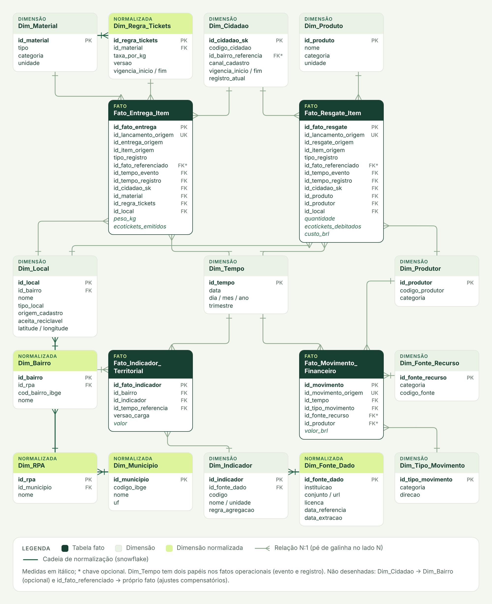

# EcoFluxo · Painel analítico

FIAP · Global Solution 2026.2 · CitizenTech · Data Science

[Vídeo Pitch](https://youtu.be/wO6sBU9StsQ?si=5Ix5i8HZ1RRC1W3W)


Gisele Santos de Lima · Grupo NeoSync · 2TSCOR

Painel que mostra, com dados públicos de Recife, por que o EcoFluxo é necessário e por onde começar. Os dados estão
organizados em um Data Warehouse com modelagem Snowflake. O painel e o relatório leem a tabela fato e as dimensões
desse modelo.

## Acesso

| Como ver | Link |
|---|---|
| Relatório analítico (abre no navegador, sem instalar nada) | https://gisele-l.github.io/ecofluxo-painel-analitico/ |
| Painel interativo (Streamlit) | https://ecofluxo-neosync.streamlit.app |
| Sem internet | abra `outputs/EcoFluxo_Relatorio_Analitico.html` |

O Streamlit Community Cloud coloca o app em repouso depois de 12 horas sem acesso. Se aparecer essa tela, clique em
**Yes, get this app back up!** e aguarde cerca de um minuto.

## Modelo dimensional



- **4 tabelas fato e 14 dimensões**, criadas por `sql/modelo_snowflake.sql` (PostgreSQL ou SQLite).
- **Com carga:** `Fato_Indicador_Territorial` (940 linhas: 94 bairros × 10 indicadores) e as dimensões
  `Dim_Bairro → Dim_RPA → Dim_Municipio`, `Dim_Local` (225 pontos de coleta), `Dim_Tempo` e
  `Dim_Indicador → Dim_Fonte_Dado`.
- **Sem carga até o piloto:** os fatos de entregas, resgates e movimentos financeiros e suas dimensões.
- **Banco:** `data/processed/ecofluxo_dw.sqlite`, com chaves primárias e estrangeiras. As tabelas também estão em CSV
  em `data/processed/`. Exemplos de consulta estão em `sql/consultas_analiticas.sql`.

O painel consulta a visão `vw_bairro_indicadores` e calcula as medidas derivadas (cobertura percentual, quintis de
renda e IPV), como prevê a seção 7.3 da documentação.

## O que o painel mostra

| Aba | Pergunta | Resultado |
|---|---|---|
| 1 · O problema | Fome e reciclagem atingem o mesmo território? | 17,7% das famílias do CadÚnico em risco de insegurança alimentar grave |
| 2 · Acesso | Quem mora perto de um ponto de recicláveis? | 32,8% dos moradores a até 500 m; 47 de 94 bairros sem ponto |
| 3 · Desigualdade | O acesso depende da renda? | 2,2 vezes mais cobertura no quintil de maior renda |
| 4 · Onde começar | Quais bairros validar primeiro? | 10 bairros com maior IPV, 138.861 moradores |
| 5 · Cenário simulado | Quantos pontos mudariam o acesso? | De 7,7% para 64,1% com 3 pontos em cada agrupamento (simulação) |
| 6 · Método e fontes | De onde vêm os números? | Modelo, controle de qualidade e fontes |

## Como rodar no Windows

Requer Python 3.11 ou 3.12. No PowerShell, dentro da pasta do projeto:

```powershell
py -3.12 -m venv .venv
.\.venv\Scripts\python.exe -m pip install -r requirements.txt
.\run_windows.bat
```

O `run_windows.bat` refaz todo o pipeline e abre o painel em `http://localhost:8501`. Etapa por etapa:

```powershell
.\.venv\Scripts\python.exe -m scripts.build_data       # bases públicas -> CSVs do modelo
.\.venv\Scripts\python.exe -m scripts.build_dw         # SQLite a partir do DDL
.\.venv\Scripts\python.exe -m scripts.simulate_sites   # cenário simulado
.\.venv\Scripts\python.exe -m scripts.export_html      # relatório HTML
.\.venv\Scripts\python.exe -m streamlit run app.py
```

Testes: `.\.venv\Scripts\python.exe -m pip install -r requirements-dev.txt` e `.\.venv\Scripts\python.exe -m pytest -q`.
Entre eles, os 56 valores publicados na documentação são recalculados a partir do Data Warehouse.

## Estrutura

```text
├── app.py                  painel Streamlit
├── index.html              entrada do GitHub Pages (abre o relatório)
├── assets/                 identidade visual e figura do modelo
├── data/raw/               bases públicas originais
├── data/processed/         CSVs do modelo, geometria dos bairros e banco SQLite
├── docs/                   documentação do projeto e definição das métricas
├── outputs/                indicadores, simulação, controle de qualidade e relatório HTML
├── scripts/                etapas do pipeline
├── sql/                    DDL do modelo e consultas analíticas
├── src/                    ETL, métricas, Data Warehouse, camada semântica e gráficos
└── tests/                  testes automatizados
```

## Fontes e privacidade

Prefeitura do Recife (pontos de coleta, bairros e RPAs, ZEIS), IBGE (Censo 2022), MDS (CadINSAN) e Cadastro Único
2023 anonimizado, usado só em agregados municipais. Os microdados do CadÚnico não fazem parte do repositório. A
definição de cada métrica está em `docs/metricas_e_fontes.md`.
